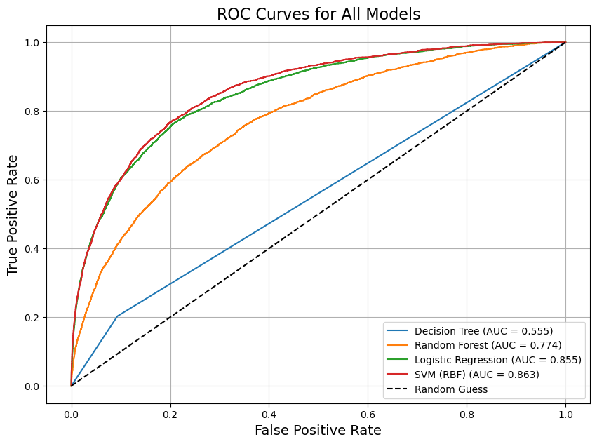
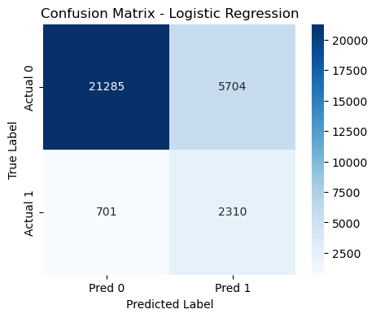
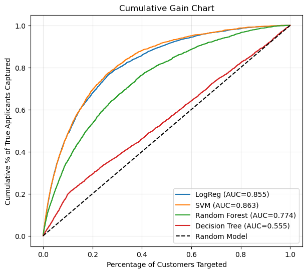
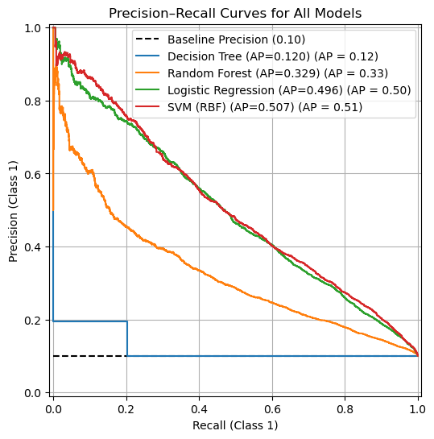

# 🏦 Predicting Business Credit Applicants

**Tools:** Python · scikit-learn · imbalanced-learn (SMOTE) · pandas · NumPy · Matplotlib · seaborn
**Context:** MSc Business Analytics, University of Warwick, Analytics in Practice module, **group project** (Group 33, December 2025)

A bank, *Universal Plus*, wanted to **spot existing customers who are likely to apply for business credit soon**, so it could contact them before they went to a competitor. A missed applicant is a lost loan, so the key business rule was to **avoid missed opportunities**. In modelling terms, that meant maximising **recall** for applicants.

We followed the **CRISP-DM** process: business understanding, data understanding, data preparation, modelling, evaluation and deployment.

📓 **[View the full notebook with code and output →](business_credit_prediction.ipynb)**

---

## 💡 Key results

**The recommended model is logistic regression.** It caught **77% of applicants** (2,310 of 3,011) on 30,000 held-out customers, with a **ROC-AUC of 0.855**.



| Model | Recall (applicants) | Precision (applicants) | ROC-AUC | Comment |
|---|---|---|---|---|
| **Logistic Regression (chosen)** | **0.77** | 0.29 | **0.855** | Best recall; fast and explainable |
| Logistic Regression + SMOTE | 0.75 | 0.29 | 0.854 | No improvement, so not used |
| Logistic Regression + feature selection (85 of 200 features) | 0.72 | 0.24 | – | Slightly worse, so all features kept |
| SVM (RBF kernel) | 0.52 | 0.46 | 0.863 | Slightly higher AUC, but missed far more applicants and was slow to train |
| Random Forest (max depth 3) | 0.64 | 0.23 | 0.774 | Many false positives |
| Random Forest (baseline) | 0.00 | 0.00 | – | 90% accuracy by predicting that no one applies |
| Decision Tree (baseline) | 0.20 | 0.20 | 0.555 | Barely better than random |

**Why logistic regression over the SVM?** The SVM's AUC was slightly higher (0.863 vs 0.855), but at the default threshold it **missed 1,441 applicants compared with 701**, it was much slower to retrain, and it's harder to explain to managers and regulators.

**Why accuracy is misleading here:** only **10% of customers applied**. A model that predicts "no" for everyone is 90% accurate and completely useless, which is exactly what the untuned Random Forest did.



### What it means for the bank



- **Targeting the top 30–40% of customers ranked by the model reaches about 80–85% of real applicants.** With no model, you'd have to contact everyone to reach them all.
- **A precision of 0.29 means about 7 in 10 contacted customers won't apply.** We judged this acceptable, because a wasted contact is cheap and a missed applicant means a lost loan.
- **Outreach plan:** relationship managers contact the highest-scoring customers, and cheaper digital channels (email, app notifications) cover the middle tier.



---

## 🔍 Approach (CRISP-DM)

**Data understanding.** The dataset has 100,000 customers and 200 anonymised numerical features (`var_0`–`var_199`), with a yes/no target. Only **10% applied**. 71 features had missing values; `var_45` was missing about 40% of its values.

**Data preparation**
- We made a **stratified 70/30 train/test split**, so both sets keep the 10% applicant rate.
- Missing values were filled with the **median**, using values from the training data only to avoid leakage.
- Features were standardised with **`StandardScaler`** for logistic regression and the SVM. The tree models used unscaled data.
- We tested **feature selection** with Information Gain (mutual information), keeping 85 features.
- We tested **SMOTE** oversampling against **`class_weight='balanced'`** for handling the imbalance.

**Modelling.** We compared Logistic Regression, Decision Tree, Random Forest and SVM (RBF), plus two Logistic Regression variants. We tuned tree depth with cross-validated grid search.

**Evaluation.** We used confusion matrices, ROC-AUC, precision–recall curves and a **cumulative gain chart**, not accuracy.

**Deployment recommendations**
- **Score customers weekly** and give the sales team a ranked lead list.
- **Repeat the same preprocessing** (median imputation and scaling) in production.
- **Monitor recall, precision and data drift** on a dashboard.
- **Retrain every 6 months**, and start with an **8–12-month pilot**.

---

## 📁 Repository structure

```
business-credit-prediction/
├── README.md
├── business_credit_prediction.ipynb   # full analysis with saved outputs
└── images/                            # charts used in this README
```

*The dataset was provided confidentially for the module, so it isn't included. The notebook is shown with its saved outputs.*

## ⚠️ Limitations and next steps

- **The features are anonymised,** so we can't explain *why* a customer scores highly. With named variables, SHAP values could show what drives each prediction.
- **Tree depth was tuned on accuracy,** which favours predicting the majority class: the tuned decision tree found almost no applicants. Tuning on recall, F1 or ROC-AUC would be a fairer test for the tree models.
- **The 0.5 decision threshold wasn't tuned.** Setting it from the bank's real cost of a missed applicant versus a wasted contact would sharpen the trade-off.
- **Try gradient boosting** (e.g. a tuned XGBoost) as a stronger tree-based challenger.
